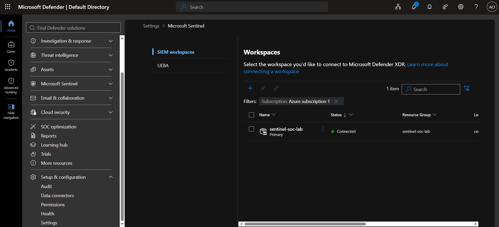
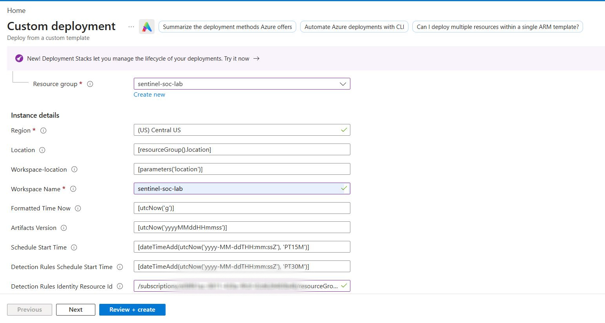
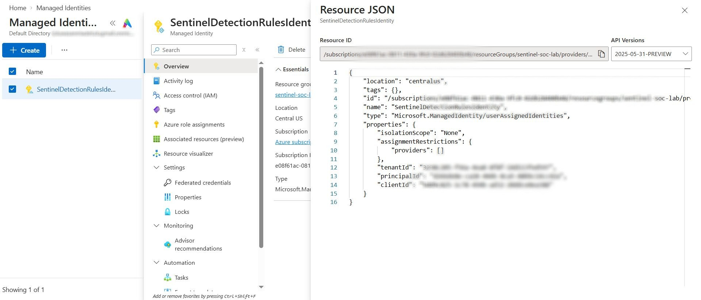
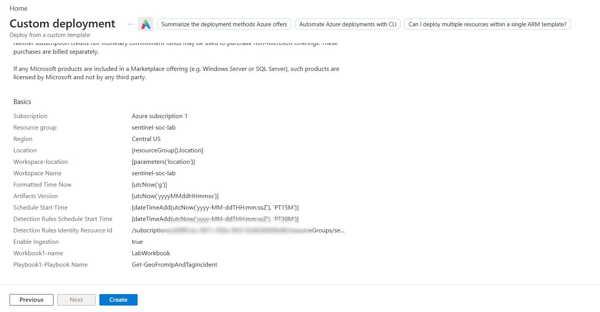
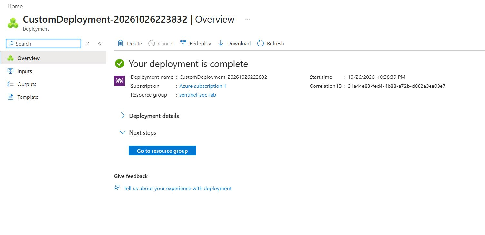
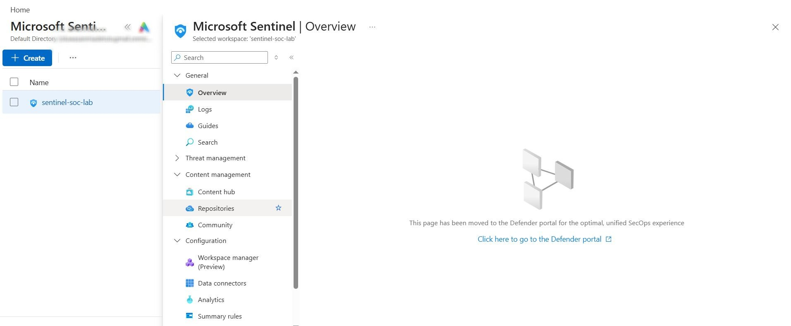
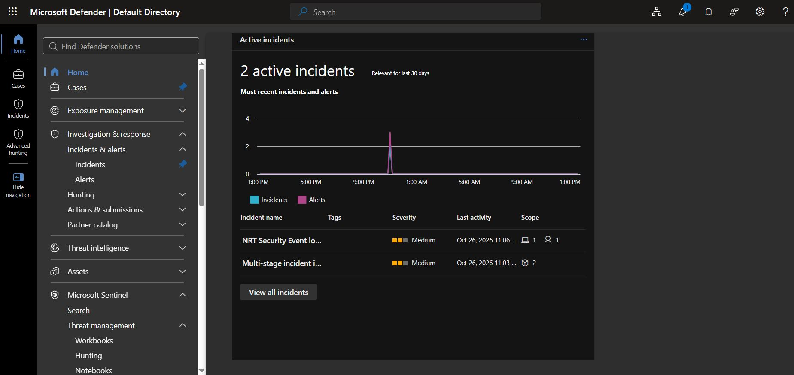
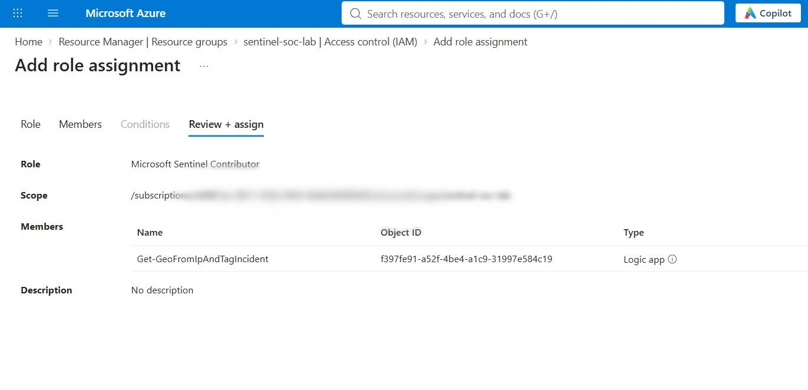

# Microsoft Sentinel Workspace Setup

The objective is to establish the Sentinel environment and prepare the resources required for security monitoring and incident response. 

# Steps

## Step 1: Create a Log Analytics workspace

1. Navigate to the [Azure portal](https://portal.azure.com/) and search for **Microsoft Sentinel**.
2. Open Microsoft Sentinel and choose the option to create a new workspace.
3. Configure the workspace by selecting the appropriate **Subscription**, **Resource Group**, **Workspace Name**, and **Region**.
4. Review the configuration and select **Create** to deploy the workspace.

## Step 2: Add Microsoft Sentinel to the workspace.

1. Navigate to the [Azure portal](https://portal.azure.com/) and open **Microsoft Sentinel**.
2. Select the workspace created in Step 1, then click **Add** to enable Microsoft Sentinel on the workspace.

## Step 3: Access Microsoft Sentinel in the Defender portal

- Go to security.microsoft.com. Access Microsoft Sentinel in the Defender portal. Go to Setup & Configuration > Settings > Microsoft Sentinel > SIEM Workspaces, verify your workspace is listed, and click Connect

## Step 4: Deploy the Microsoft Sentinel Training Lab

In this step, you will deploy the resources needed to complete the Microsoft Sentinel training exercises.

The deployment automatically sets up sample security data (approximately 20 MB), analytics rules, workbooks, watchlists, and playbooks.

### Before you begin

Make sure you have completed the previous steps and created your Microsoft Sentinel workspace.

If you want to deploy custom detection rules, you must also complete the **Custom Detection Rules Setup** described in the [Prerequisites Page](./00-prerequisites).

This setup creates a User-Assigned Managed Identity (UAMI), which allows the deployment to create and manage custom detection rules.

**Don't need custom detection rules?** You can skip that setup and leave the identity field empty during deployment.

### 1. Open the Azure deployment page

Select the link below to open the deployment page in the Azure portal.

[**Deploy the Microsoft Sentinel Training Lab to Azure**](https://portal.azure.com/#create/Microsoft.Template/uri/https%3A%2F%2Fraw.githubusercontent.com%2FAzure%2FAzure-Sentinel%2Fmaster%2FTools%2FMicrosoft-Sentinel-Training-Lab%2FPackage%2FmainTemplate.json)

### 2. Enter your deployment details

On the deployment page, fill in the following fields:

- **Subscription:** Select the Azure subscription you used in the previous steps.
- **Resource Group:** Select the resource group containing your existing Microsoft Sentinel workspace.
- **Workspace:** Select the workspace you created earlier.
- **Region:** Select the same region as your existing workspace.
- **Detection Rules Identity Resource Id:** If you completed the Custom Detection Rules Setup, enter the full resource ID of your User-Assigned Managed Identity (UAMI).

**How do I find my UAMI resource ID?**

1. Open the [Azure portal](https://portal.azure.com/).
2. Search for **Managed Identities** in the search bar.
3. Select **SentinelDetectionRulesIdentity**.
4. On the identity's **Overview** page, look for **JSON View** (sometimes available from the top menu).
5. Copy the entire resource ID and paste it into the **Detection Rules Identity Resource Id** field on the deployment page.

If you have not created the identity because you want to skip custom detection rules, leave this field empty.

### 3. Start the deployment

Once you have entered all the required details:

1. Select **Review + create**.
2. Review your settings.
3. Select **Create** to start the deployment.

The deployment usually takes around **15 minutes**. Wait until Azure confirms that it has completed successfully.

### 4. Check that the deployment worked

After the deployment finishes:

1. Open Microsoft Sentinel in the Azure portal.
3. Open the Sentinel overview or home page. If the data is not avaliable there, move to the Defender platform.

4. Check that the sample data has been ingested and that recent incidents are visible.

### 5. Give the playbook permission to run automatically

The deployment also creates a playbook using an Azure Logic App. For the playbook to run automatically, its managed identity needs permission to work with Microsoft Sentinel.

Follow these steps:

1. Open the **Resource Group** containing your training lab.
2. Select **Access control (IAM)**.
3. Select **Add** → **Add role assignment**.
4. Choose the **Microsoft Sentinel Contributor** role.
5. For the assignment type, select **Managed identity**.
6. Select the Logic App created by the deployment.
7. Select **Review + assign** or **Save** to complete the assignment.

This gives the Logic App's system-assigned managed identity the permissions it needs to perform its Sentinel-related tasks within the resource group's scope.

**Important:** Select the Logic App's identity, not the User-Assigned Managed Identity used for custom detection rules. They serve different purposes.

### Step 4 checklist

- [ ] Selected the correct subscription, resource group, workspace, and region.
- [ ] Entered the UAMI resource ID, or left the field empty to skip custom detection rules.
- [ ] Completed the deployment successfully.
- [ ] Checked that the sample data and incidents are available in Microsoft Sentinel/ Microsoft Defender.
- [ ] Assigned the Microsoft Sentinel Contributor role to the Logic App's managed identity.

