# Data Exploration and Custom Detection

## Project Overview

This project focuses on exploring security telemetry in a Microsoft Sentinel training environment, investigating potentially suspicious activity across multiple data sources, and developing a custom detection rule using Kusto Query Language (KQL).

The goal was to understand how security events from endpoint, network, identity, and cloud environments can be analyzed to identify patterns associated with potential cyberattacks.

## Objectives

- Explore available security tables and understand the data they contain.
- Investigate endpoint alerts from CrowdStrike.
- Analyze Palo Alto Networks firewall traffic.
- Review Okta authentication events for suspicious login activity.
- Examine AWS CloudTrail events for potentially malicious cloud operations.
- Correlate events across multiple data sources.
- Develop a custom detection rule for endpoints exhibiting multi-tactic attack activity.

# Steps

## Step 1: Discover Available Tables

Identify which tables contain data and how many events they hold.

1. Open the Microsoft Defender portal.
2. Navigate to **Microsoft Sentinel > Logs**.
3. Run the following query:

```kusto
search *
| summarize EventCount = count() by $table
| sort by EventCount desc
```

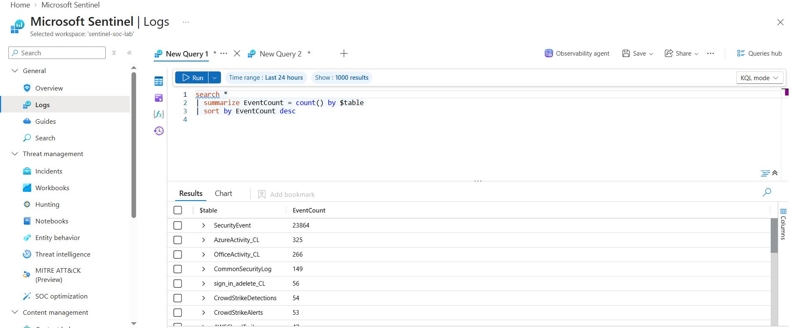

**Expected result:** A list of tables containing data, such as `CommonSecurityLog`, `AWSCloudTrail`, `CrowdStrikeAlerts`, `CrowdStrikeDetections`, `OktaV2_CL`, and `SecurityEvent`.


> **NOTE: KQL Query Compatibility**
>
> The following query works in Microsoft Sentinel Logs but fails in Microsoft Defender XDR Advanced Hunting:
>
> ```kusto
> search *
> | summarize EventCount = count() by $table
> | sort by EventCount desc
> ```
>
> **Error:** `Semantic error - Operator source expression should be table or column.`
>
> **Reason:** Although both platforms use KQL, they support different query capabilities and access different data environments. Microsoft Sentinel Logs supports workspace-wide searches using `search *` and grouping results by `$table`. The error occurs because Defender Advanced Hunting cannot interpret search * as a valid table or column source in this query.
>
> **Impact:** This error does not, by itself, indicate a problem with the Sentinel-Defender XDR integration.
>
> **Workaround:** Run the original query in Microsoft Sentinel Logs. In Defender Advanced Hunting, query specific supported tables instead.


## Step 2: Explore CrowdStrike Alerts

Identify the alerts generated by CrowdStrike and the devices involved.

### Query 1: Summarize Alerts

```kusto
CrowdStrikeAlerts
| summarize AlertCount = count() by Name, SeverityName, Tactic
| sort by AlertCount desc
```

**What to look for:**

- Alert names and severity levels.
- The number of alerts generated.
- MITRE ATT&CK tactics associated with each alert.

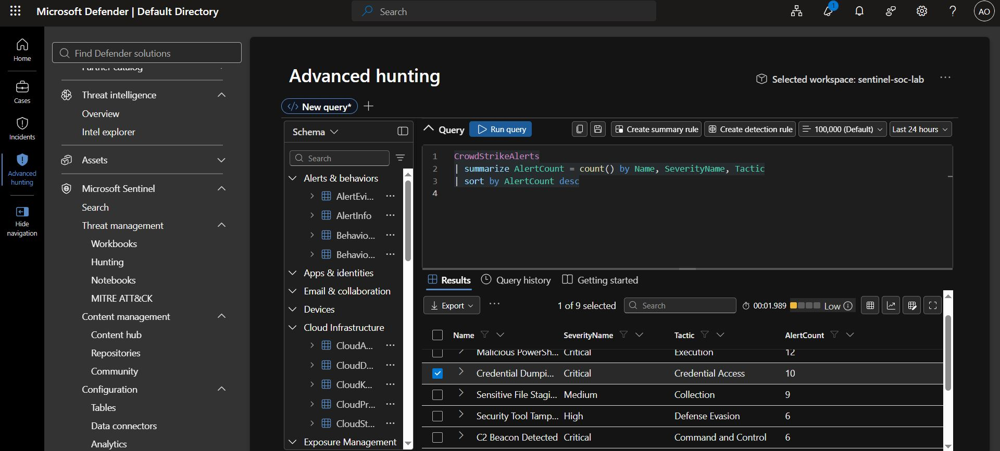

### Query 2: Investigate Alerts by Device

```kusto
CrowdStrikeAlerts
| extend DeviceName = tostring(split(DisplayName, " on ")[-1])
| summarize
    AlertCount = count(),
    Tactics = make_set(Tactic),
    FirstAlert = min(TimeGenerated),
    LastAlert = max(TimeGenerated)
    by DeviceName
| sort by AlertCount desc
```

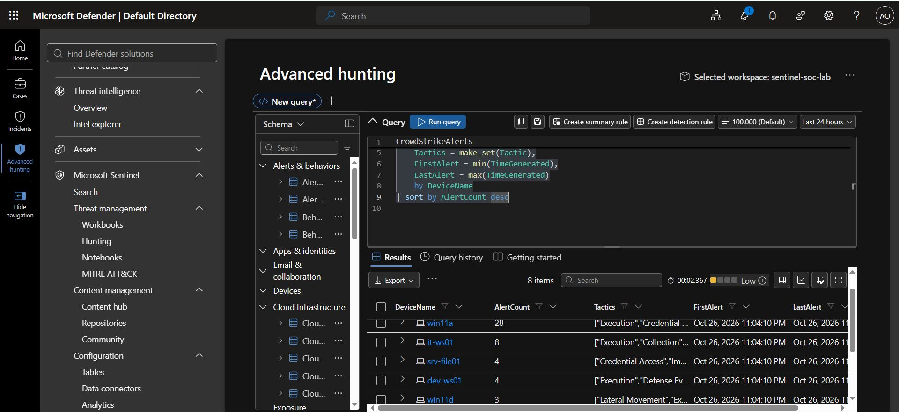


## Step 3: Explore Palo Alto Firewall Traffic

Understand network activity and identify sources generating blocked connections.

### Query 1: Summarize Firewall Traffic

```kusto
CommonSecurityLog
| where DeviceVendor == "Palo Alto Networks"
| summarize
    TotalEvents = count(),
    DistinctSources = dcount(SourceIP),
    DistinctDestinations = dcount(DestinationIP)
    by Activity
| sort by TotalEvents desc
```

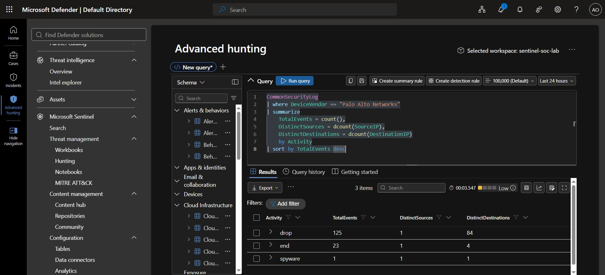

### Query 2: Identify Blocked Connections

```kusto
CommonSecurityLog
| where DeviceVendor == "Palo Alto Networks"
| where Activity in ("drop", "deny", "reset-both")
| summarize
    BlockedConnections = count(),
    TargetedPorts = dcount(DestinationPort)
    by SourceIP
| sort by BlockedConnections desc
| take 10
```

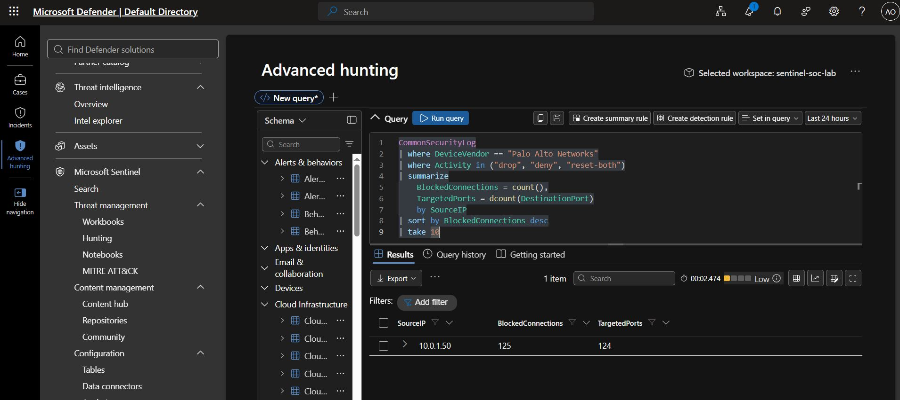


## Step 4: Explore Okta Identity Events

Identify unusual authentication activity and possible account attacks.

### Query 1: Summarize Identity Events

```kusto
OktaV2_CL
| summarize EventCount = count() by EventOriginalType, OriginalOutcomeResult
| sort by EventCount desc
```

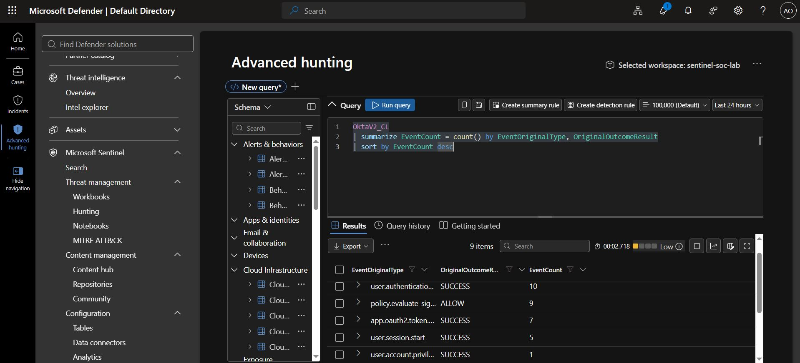

### Query 2: Investigate Failed Logins

```kusto
OktaV2_CL
| where OriginalOutcomeResult == "FAILURE"
| summarize
    FailedAttempts = count(),
    DistinctIPs = dcount(SrcIpAddr),
    Countries = make_set(SrcGeoCountry)
    by ActorUsername
| sort by FailedAttempts desc
```

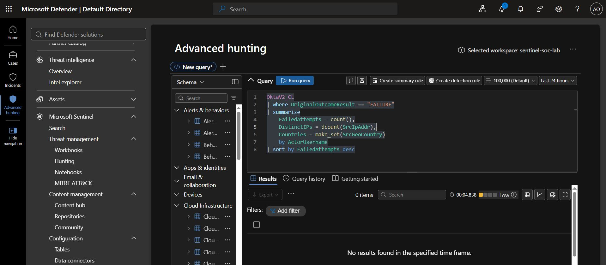


## Step 5: Explore AWS CloudTrail Activity

Understand AWS API activity and identify failed operations.

### Query 1: Identify Common AWS Operations

```kusto
AWSCloudTrail
| summarize EventCount = count() by EventName, EventSource
| sort by EventCount desc
| take 15
```
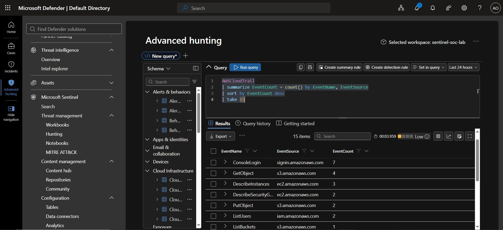

### Query 2: Investigate Failed AWS Operations

```kusto
AWSCloudTrail
| where isnotempty(ErrorCode)
| summarize
    FailedCalls = count(),
    ErrorCodes = make_set(ErrorCode)
    by UserIdentityUserName, EventName
| sort by FailedCalls desc
```

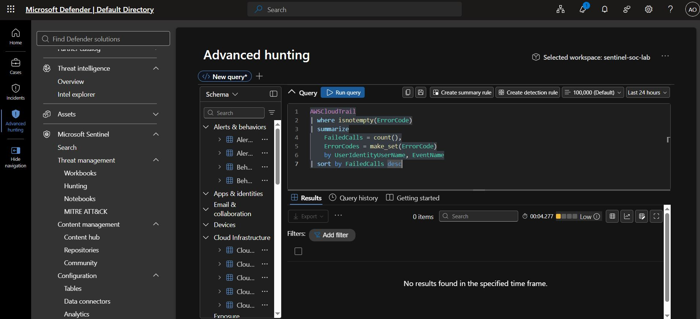


## Step 6: Build a Cross-Source Security Timeline

Combine suspicious events from multiple security tools into one chronological timeline.

```kusto
union
    (
        CrowdStrikeAlerts
        | where SeverityName in ("Critical", "High")
        | project
            TimeGenerated,
            Source = "CrowdStrike",
            Activity = Name,
            Severity = SeverityName
    ),
    (
        CommonSecurityLog
        | where DeviceVendor == "Palo Alto Networks"
        | where DeviceEventClassID == "THREAT"
        | project
            TimeGenerated,
            Source = "Palo Alto",
            Activity = Activity,
            Severity = LogSeverity
    ),
    (
        OktaV2_CL
        | where EventOriginalType has "mfa"
            or EventOriginalType has "deactivate"
        | project
            TimeGenerated,
            Source = "Okta",
            Activity = EventOriginalType,
            Severity = EventSeverity
    ),
    (
        AWSCloudTrail
        | where EventName in (
            "CreateUser",
            "AttachUserPolicy",
            "CreateAccessKey",
            "StopLogging"
        )
        | project
            TimeGenerated,
            Source = "AWS",
            Activity = EventName,
            Severity = "High"
    )
| sort by TimeGenerated asc
```

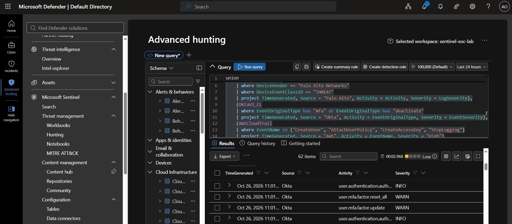

**What to look for:** Events that may be related across endpoint, firewall, identity, and cloud environments.

Review the timestamps and event details to determine whether the activities may be connected to the same incident.


# Create a Custom Detection Rule

## Step 7: Write and Test the Detection Query

Detect a device with high-severity CrowdStrike alerts spanning at least three distinct MITRE ATT&CK tactics within four hours.

### Detection Query

```kusto
CrowdStrikeAlerts
| where TimeGenerated > ago(24h)
| where SeverityName in ("Critical", "High")
| extend DeviceName = tostring(split(DisplayName, " on ")[-1])
| summarize
    TacticCount = dcount(Tactic),
    Tactics = make_set(Tactic),
    AlertNames = make_set(Name, 10),
    AlertCount = count(),
    FirstSeen = min(TimeGenerated),
    LastSeen = max(TimeGenerated)
    by DeviceName, AgentId
| where TacticCount >= 3
| project
    TimeGenerated = FirstSeen,
    DeviceName,
    TacticCount,
    Tactics,
    AlertNames,
    AlertCount,
    FirstSeen,
    LastSeen,
    ReportId = tostring(hash_sha256(strcat(DeviceName, tostring(FirstSeen))))
```

### How the query works 

- Filters alerts to the last 24 hours.
- Keeps only `Critical` and `High` severity alerts.
- Extracts the device name from the alert display name.
- Groups alerts by device name and agent ID.
- Counts distinct MITRE ATT&CK tactics.
- Returns groups containing at least three distinct tactics.
- Displays alert names, counts, and timestamps.
- Generates a hash-based report identifier.

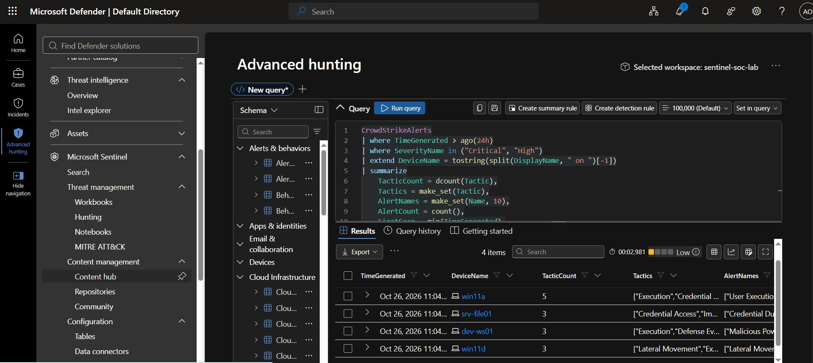


## Step 8: Create the Custom Detection Rule

1. Open **Investigation & Response > Hunting > Advanced Hunting**.
2. Paste the detection query into the editor.
3. Run the query.
4. Review the results.
5. After testing the query, select **Create detection rule**.
6. Review the configuration and select **Submit** to save the rule.

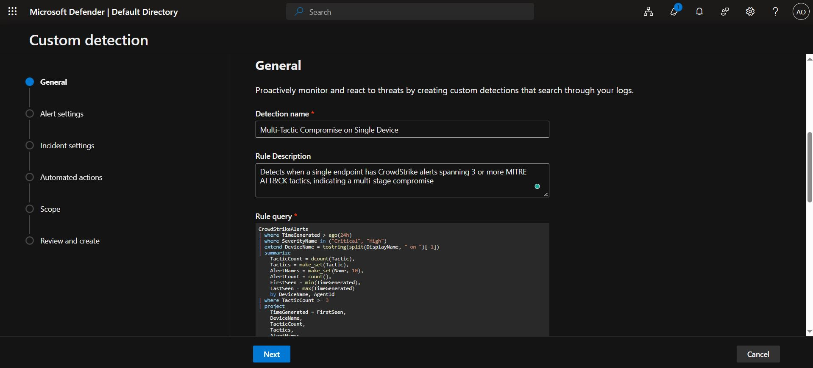

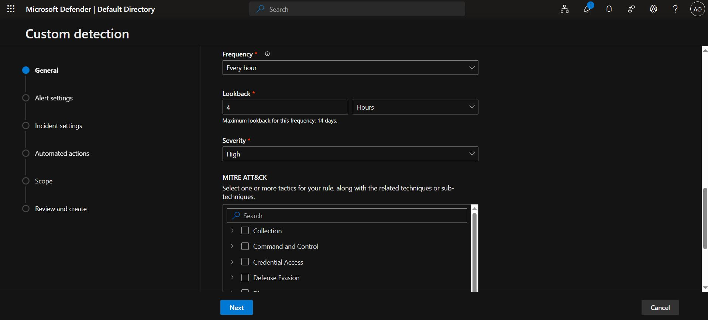

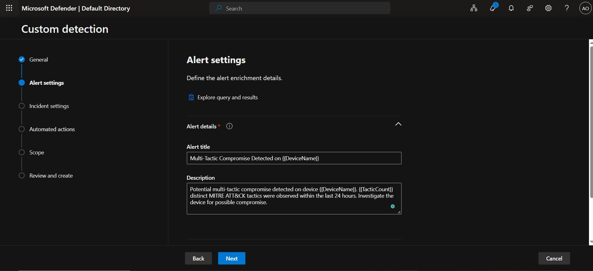

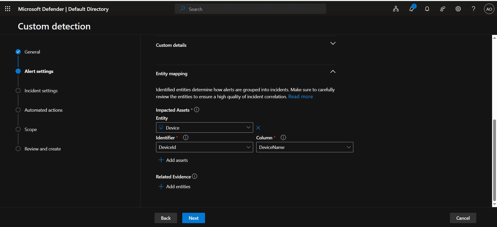

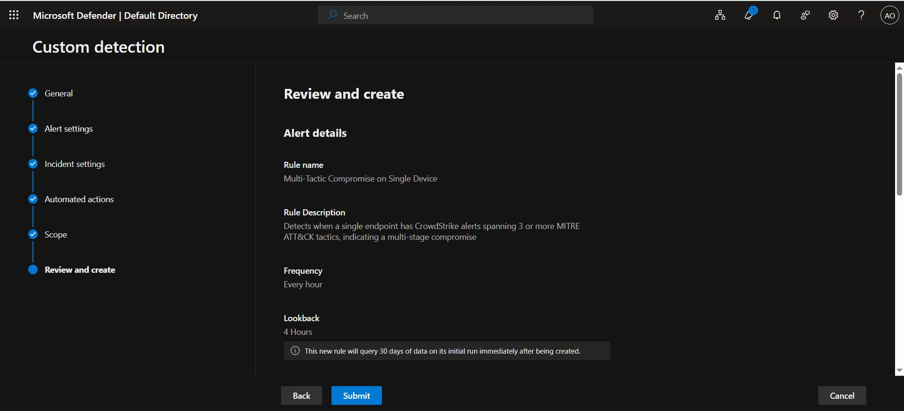


## Step 9: Verify the Detection Rule

Confirm that the rule was created successfully and check whether it generates alerts.

1. Navigate to **Investigation & Response > Hunting > Custom detection rules**.
2. Find `Multi-Tactic Compromise on Single Device`.
3. Open the rule and select **Run**, if manual execution is supported.
4. Review the execution results and **Triggered alerts**.
5. Investigate any generated alerts and the associated devices and tactics.

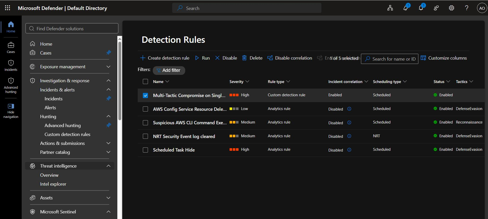

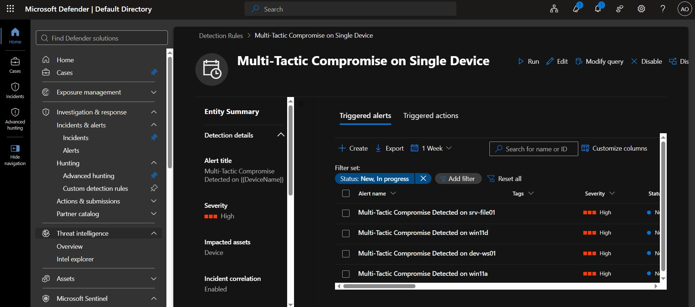

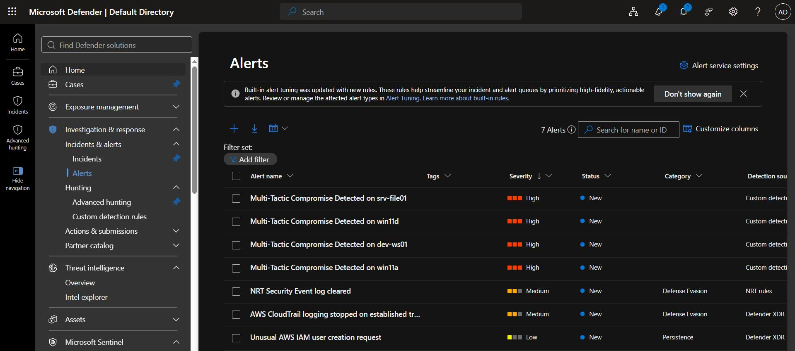

---

## Lessons learnt

- Table names and field availability depend on the data connectors and lab configuration.
- The table schema should be checked if a query fails.
- No alerts does not necessarily mean the rule is broken. There may be no matching events.
- Custom detection rules may have additional query, scheduling, entity-mapping, or licensing requirements.
- Suspicious patterns indicate activity that requires investigation; they do not independently prove a compromise.

## Conclusion

Understanding security telemetry is the first step toward effective threat detection. By exploring multiple data sources, identifying suspicious patterns, and creating custom detection rules, SOC analysts can improve their ability to detect and investigate potential attacks.

## Disclaimer

This project was conducted in a training environment for educational and portfolio purposes. Suspicious patterns identified by the queries require further investigation and do not, by themselves, confirm a security compromise.

