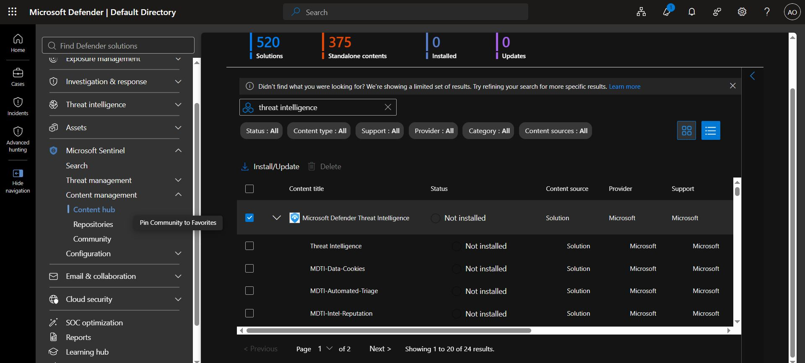
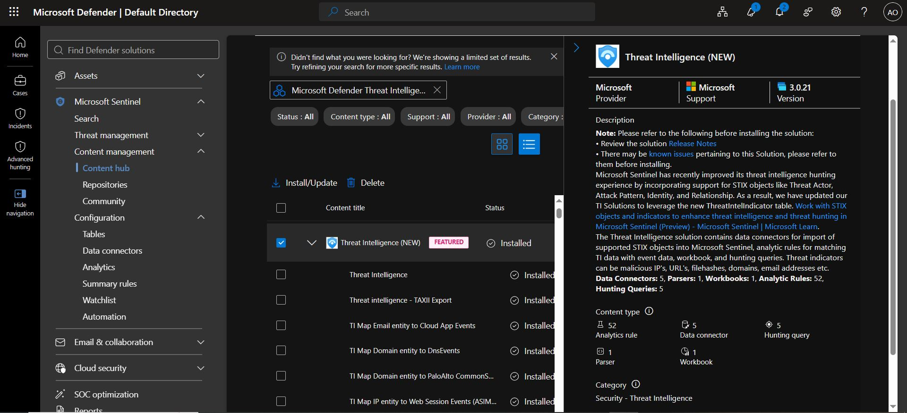
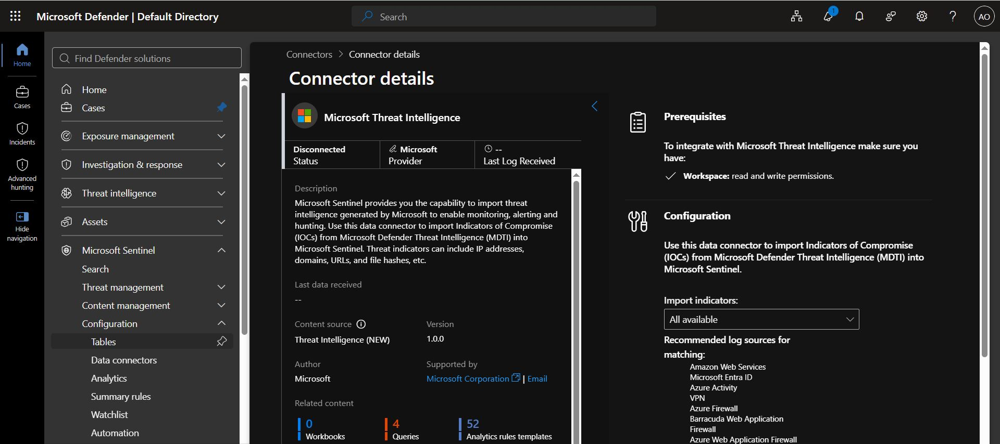
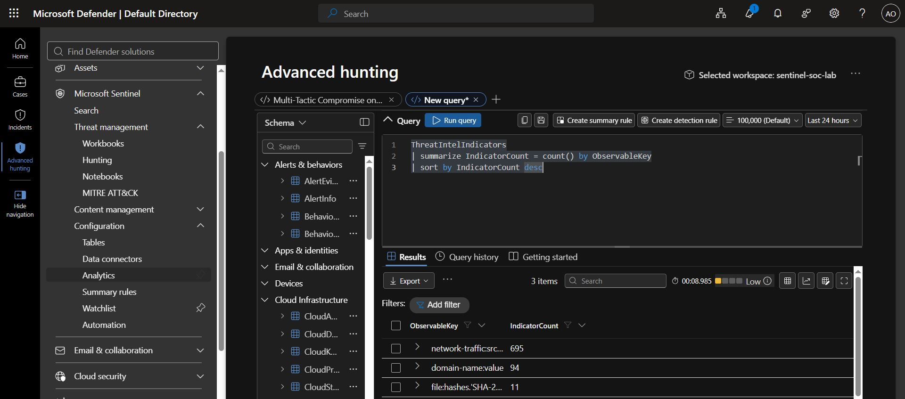
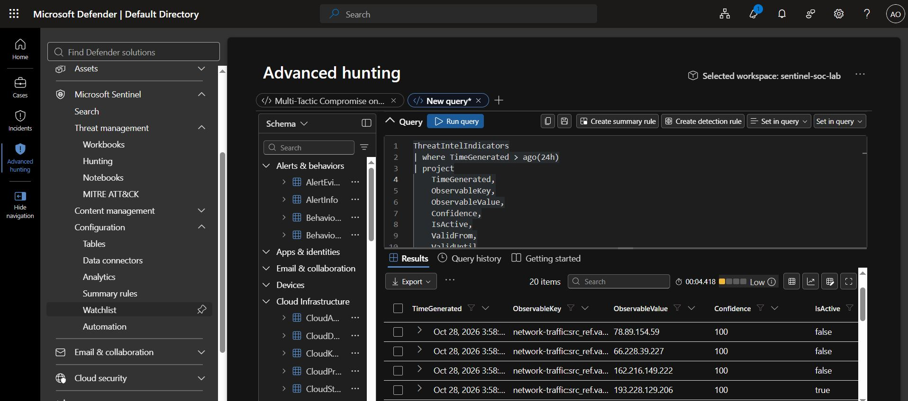
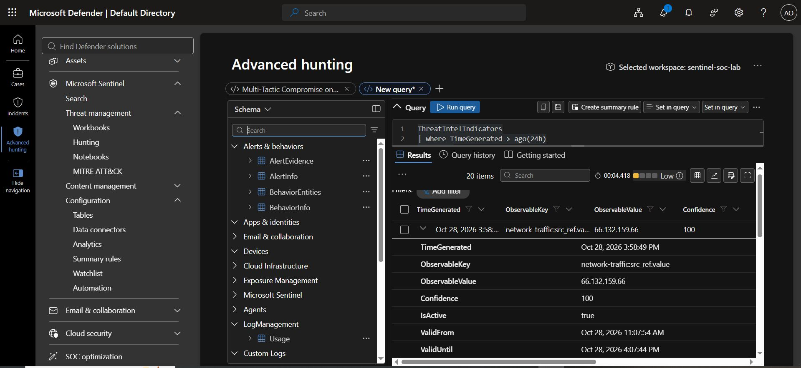
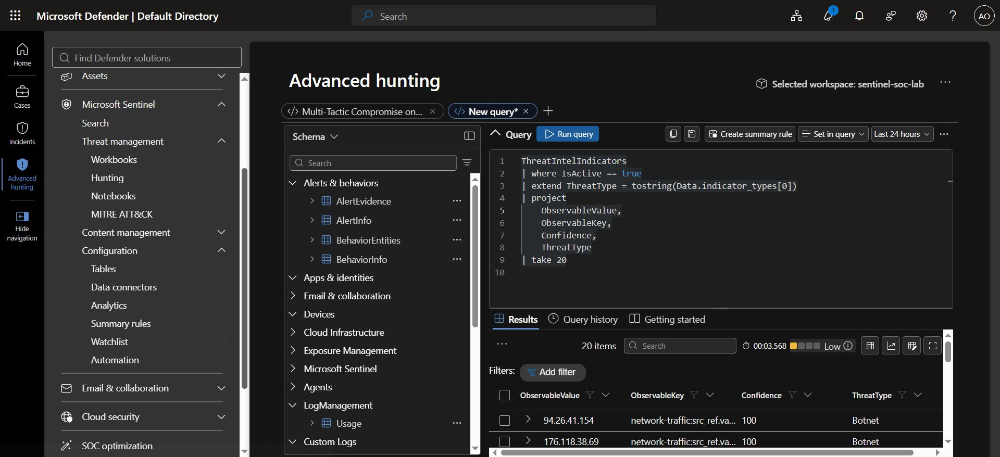
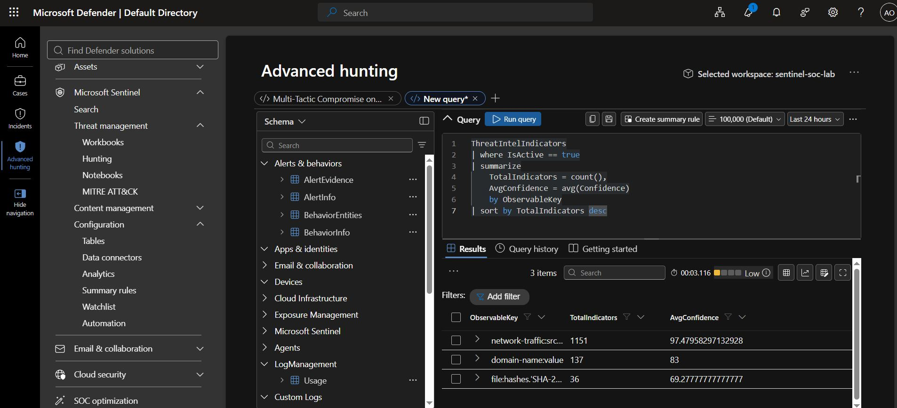
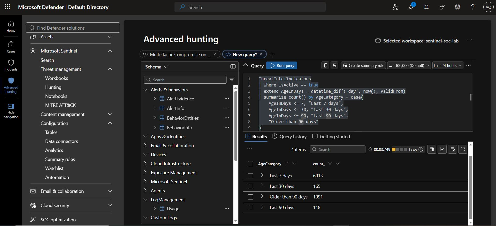
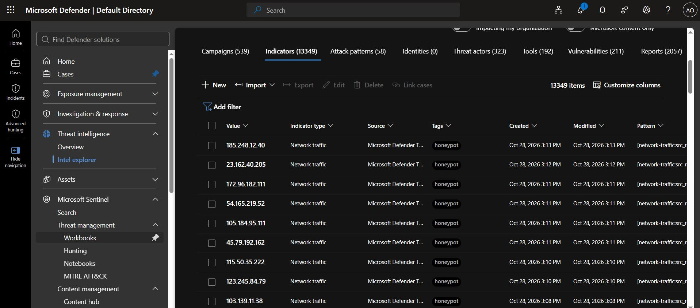

# Threat Intelligence with Microsoft Defender and Microsoft Sentinel

## Project Overview

This is focused on learning how to use Microsoft Defender Threat Intelligence (MDTI) with Microsoft Sentinel.

The goal is to collect threat intelligence indicators, analyse them using Kusto Query Language (KQL), and compare them against security logs to identify potentially suspicious activity.

Through this project, I want to gain practical experience with threat intelligence, threat hunting, and security event investigation.

## Objectives

- Enable the Microsoft Defender Threat Intelligence data connector.
- Verify that threat intelligence indicators are ingested into the `ThreatIntelIndicators` table.
- Explore and analyse indicators of compromise (IOCs) using KQL.
- Match threat intelligence indicators against firewall and cloud activity logs.
- Understand indicator confidence scores, validity periods, and threat context.
- Investigate potential matches and document my findings.


## Step 1: Enable the MDTI Data Connector

### Install the Threat Intelligence Solution

1. Open the [Microsoft Defender portal](https://security.microsoft.com).
2. Navigate to **Microsoft Sentinel > Content management > Content hub**.
4. Search for **Threat Intelligence**.
5. Select the **Threat Intelligence New** solution and Install.





### Connect Microsoft Defender Threat Intelligence

1. Navigate to **Microsoft Sentinel > Configuration > Data connectors**.
2. Search for **Microsoft Threat Intelligence**.
3. Open the connector page.
4. Follow the configuration instructions and select **Connect**, if available.
5. Confirm that the connector reports a connected status.



Allow time for the initial ingestion of indicators. The connector is enabled and threat intelligence data begins appearing in the Sentinel workspace.


## Step 2: Verify Threat Intelligence Ingestion

### Count Indicators by Type

```kusto
ThreatIntelIndicators
| summarize IndicatorCount = count() by ObservableKey
| sort by IndicatorCount desc
```

This query counts the available indicators by observable type.

Examples include:

- `ipv4-addr` - IP addresses
- `domain-name` - Domain names
- `url` - URLs
- File hash patterns, such as SHA-256



### View Recent Indicators

```kusto
ThreatIntelIndicators
| where TimeGenerated > ago(24h)
| project
    TimeGenerated,
    ObservableKey,
    ObservableValue,
    Confidence,
    IsActive,
    ValidFrom,
    ValidUntil
| sort by TimeGenerated desc
| take 20
```



This query displays up to 20 indicators recorded during the last 24 hours.

It allows me to review indicator values, confidence scores, active status, and validity periods.


## Step 3: Understand the ThreatIntelIndicators Table

The `ThreatIntelIndicators` table stores structured threat intelligence information.

| Column | Description |
|---|---|
| `TimeGenerated` | Time the record was generated or ingested into the workspace. |
| `ObservableKey` | Type of observable, such as an IP address or domain. |
| `ObservableValue` | The actual indicator value. |
| `Confidence` | Confidence score associated with the indicator. |
| `IsActive` | Indicates whether the indicator is marked as active. |
| `ValidFrom` | Start of the indicator's validity period. |
| `ValidUntil` | End of the indicator's validity period, if specified. |
| `Pattern` | STIX expression describing the indicator. |
| `Data` | Structured data containing additional indicator information. |




### Explore Indicator Context

```kusto
ThreatIntelIndicators
| where IsActive == true
| extend ThreatType = tostring(Data.indicator_types[0])
| project
    ObservableValue,
    ObservableKey,
    Confidence,
    ThreatType
| take 20
```



This query attempts to extract the first indicator type from the `Data` field. The available fields may vary, so I will inspect the actual records if the query returns empty values.


## Step 4: Match Threat Intelligence Against Security Logs

The main objective is to compare known threat indicators with activity recorded in my environment.

An indicator match may identify suspicious activity, but it does not automatically prove that a system has been compromised.

### 4.1 Match Indicators Against Firewall Logs

The following query compares active IP indicators with destination IP addresses in Palo Alto Networks firewall logs.

```kusto
let ti_ips =
    ThreatIntelIndicators
    | where IsActive == true
    | where ObservableKey == "ipv4-addr"
    | where Confidence > 50
    | project
        ObservableValue,
        Confidence;
CommonSecurityLog
| where DeviceVendor == "Palo Alto Networks"
| join kind=inner ti_ips
    on $left.DestinationIP == $right.ObservableValue
| project
    TimeGenerated,
    SourceIP,
    DestinationIP,
    DeviceAction,
    TI_Confidence = Confidence
| sort by TimeGenerated desc
```

**How it works:**

1. Selects active IP indicators with confidence scores above 50.
2. Retrieves firewall events from Palo Alto Networks.
3. Matches destination IP addresses against the threat intelligence indicators.
4. Displays matching events and their associated confidence scores.
5. Sorts the results by time.

The `join kind=inner` operation returns only records where the firewall destination IP matches an indicator. If matching activity exists, the query displays firewall events associated with known threat indicators.


### 4.2 Match Indicators Against AWS CloudTrail

```kusto
let ti_ips =
    ThreatIntelIndicators
    | where IsActive == true
    | where ObservableKey == "ipv4-addr"
    | where Confidence > 50
    | project
        ObservableValue,
        Confidence;
AWSCloudTrail
| join kind=inner ti_ips
    on $left.SourceIpAddress == $right.ObservableValue
| project
    TimeGenerated,
    UserIdentityUserName,
    EventName,
    SourceIpAddress,
    TI_Confidence = Confidence
| sort by TimeGenerated desc
```

This query compares AWS CloudTrail source IP addresses against active threat intelligence indicators. If a match is found, I will investigate the event name, user identity, source IP, and timestamp.

> **Note:** The queries returned no results in the lab environment. This is expected because the pre-ingested security logs may contain synthetic IP addresses that do not match indicators in Microsoft's real-world threat intelligence feed. This does not necessarily indicate a problem with the queries or the threat intelligence configuration.
>
> **Key takeaway:** The main objective is to understand the query pattern. Using `join kind=inner` allows you to compare threat intelligence indicators with security logs and identify matching events. You can apply the same technique to firewall logs, cloud activity logs, and identity events. In a production environment, results depend on whether the logs contain values that match the available threat intelligence indicators.


## Step 5: Analyse Threat Intelligence Statistics

### 5.1 Count Active Indicators and Average Confidence

```kusto
ThreatIntelIndicators
| where IsActive == true
| summarize
    TotalIndicators = count(),
    AvgConfidence = avg(Confidence)
    by ObservableKey
| sort by TotalIndicators desc
```



This query shows the number of active indicators for each observable type and their average confidence score.

### 5.2 Analyse Indicator Age

```kusto
ThreatIntelIndicators
| where IsActive == true
| extend AgeInDays = datetime_diff('day', now(), ValidFrom)
| summarize IndicatorCount = count()
    by AgeCategory = case(
        AgeInDays <= 7, "Last 7 days",
        AgeInDays <= 30, "Last 30 days",
        AgeInDays <= 90, "Last 90 days",
        "Older than 90 days"
    )
| sort by IndicatorCount desc
```

This query groups active indicators according to how long ago their validity began. Older indicators are not necessarily unreliable. I will consider their validity periods and available context before drawing conclusions.




## Step 6: Explore the Threat Intelligence Interface

I also explore the Sentinel interface to understand how threat intelligence can be reviewed without writing queries.

- Navigate to **Microsoft Defender > Threat intelligence > Intel Explorer**
- Search for specific IP addresses, domains, URLs, and file hashes.
- Review indicator details and confidence scores.
- Examine validity periods, descriptions, and labels.
- Investigate associated threat context.
- Explore available options for managing or adding indicators.
- Review hunting queries, analytics rules, and workbooks included with the installed solution.




## Lessons

- Microsoft Defender Threat Intelligence provides intelligence that can support security investigations.
- The `ThreatIntelIndicators` table is the primary table used in this project to explore indicator data.
- KQL can filter, analyse, and correlate threat intelligence with security logs.
- The `join kind=inner` operation identifies events whose IP addresses match known indicators.
- Confidence scores and active status help prioritise investigations but do not guarantee that an indicator is malicious.
- A matching indicator is a starting point for investigation, not proof of compromise.
- Threat intelligence is most useful when combined with telemetry from the environment being investigated.

