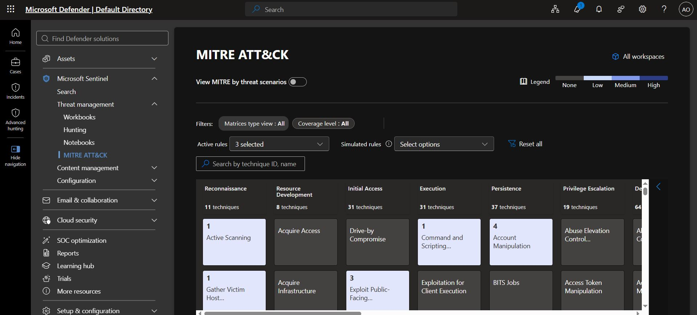
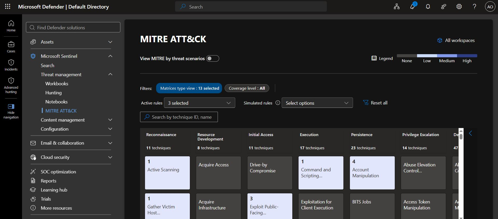
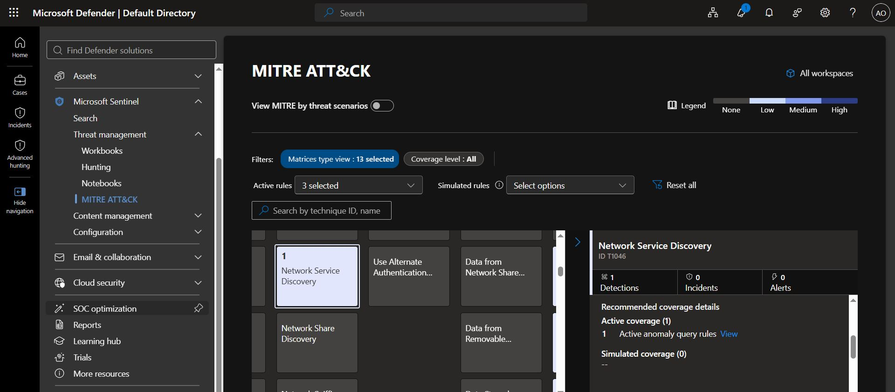
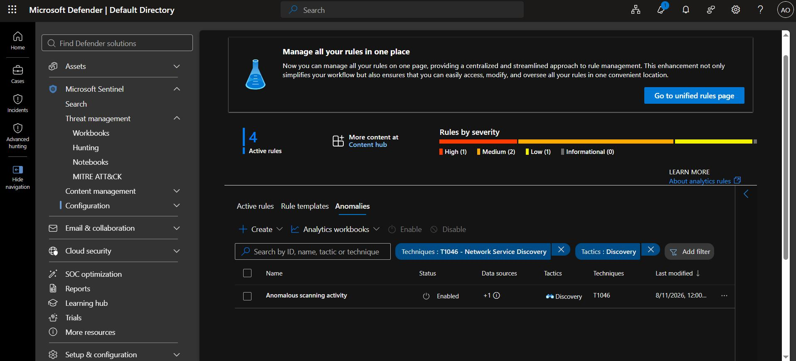

# MITRE ATT&CK Detection Coverage

MITRE ATT&CK stands for Adversarial Tactics, Techniques, and Common Knowledge. MITRE ATT&CK is a framework that describes how hackers attack systems, what they do after getting in, and the techniques they use to achieve their goals. It is like a guide to attacker behaviour that cybersecurity professionals use to understand attacks, investigate threats, and build security detections.

MITRE ATT&CK organises attacker behaviour using tactics, techniques, and sub-techniques. 

| Term | Simple Meaning | Example |
|---|---|---|
| Tactic | Why the attacker does something | Credential Access: The attacker wants passwords or other credentials. |
| Technique | How the attacker achieves that goal | T1003: OS Credential Dumping. |
| Sub-technique | A more specific way of carrying out the technique | A specific method of extracting credentials from an operating system. |


## How Does the MITRE Coverage Matrix Help Identify Gaps?

Suppose your matrix shows the following:

| MITRE Technique | Coverage | What You Should Investigate |
|---|---|---|
| T1566 - Phishing | Covered | Are the mapped rules enabled and detecting the relevant email activity? |
| T1003.001 - LSASS Memory | Covered | Is endpoint telemetry available, and does the rule work as intended? |
| T1046 - Network Service Discovery | Covered | Do the firewall logs support reliable detection of port scans? |
| T1021 - Remote Services | No mapped rule | Do you need additional endpoint or network detections? |
| T1560 - Archive Collected Data | No mapped rule | Do you have telemetry that could identify suspicious file archiving? |

An uncovered technique is a potential detection gap, not automatic proof of a vulnerability.

You must investigate whether the technique is relevant to your environment, whether you have the necessary logs, and whether an existing detection already covers the behaviour without an explicit mapping.

Similarly, a shaded cell does not prove that the detection works well. It only indicates mapped coverage in the selected view.

A useful way to assess a technique is to ask three questions:

1. **Coverage:** Is a detection rule mapped to this technique?
2. **Readiness:** Is the rule enabled, and is the required data available?
3. **Effectiveness:** Does the rule reliably identify the suspicious activity it was designed to detect?


## Project Overview

The goal of this project is to explore the MITRE ATT&CK matrix, check which attack techniques the detection rules cover, identify missing detections, and consider how I could improve my security monitoring.

In this Microsoft Sentinel project, detection rules are mapped to MITRE ATT&CK techniques so you can see which types of attacks your security monitoring cover

A detection rule identifies suspicious activity, while MITRE ATT&CK classifies the type of attacker behaviour that the rule is designed to detect.


## Step 1: Open the MITRE ATT&CK Matrix

1. Sign in to the [Microsoft Defender portal](https://security.microsoft.com/).
2. Open Microsoft Sentinel.
3. Select my workspace.
4. Navigate to **Threat management → MITRE ATT&CK**. 

The MITRE ATT&CK matrix displays different techniques that attackers use during cyberattacks.Some cells are shaded, while others are not. In this lab, shaded cells indicate that at least one selected detection or coverage source is associated with t hat technique. The number displayed in a cell indicates how many rules or other coverage items are associated with it, depending on the selected filters.

My first task is to explore the matrix and understand how the coverage information is presented.



## Step 2: Display Only Active Analytics Rules

To focus on the detection rules configured in my Sentinel environment rather than other coverage sources;

1. Open the matrix filters.
2. Diselect all simulated coverage sources.
3. Select **Active → Analytics rules**.
4. Apply the filters.



Examine which techniques are covered by the selected analytics rules abd also check whether the rules are enabled. A technique can be mapped to a rule that exists in the workspace but is disabled, so I should not assume that every mapped rule is actively detecting threats.

## Step 3: Investigate a Covered Technique

Starting with **Network Service Discovery**, which describes activity such as scanning a network to identify available services.

1. Find T1046 under the Discovery tactic.
2. Select the shaded cell.
3. Review the technique description.
4. Examine the analytics rules associated with it.
5. Check whether the relevant rules are enabled or disabled.





**What I want to understand:** How does Sentinel connect a detection rule to a MITRE ATT&CK technique, and what evidence tells me that the rule is relevant to that technique?

## Step 4: Find Gaps in Detection Coverage

Next, I look for important techniques that do not appear to have coverage in the filtered matrix.

For each potential gap, ask:

- Is this technique relevant to the threats I want to detect?
- Do I have the logs needed to identify it?
- Is there already a rule that detects similar behaviour?
- Would creating a new rule meaningfully improve my security monitoring?

## Step 5: Develop a New Detection Idea

After identifying a possible gap, choose one technique and design a detection rule that could help address it.

For this exercise, I will use **T1110.003 — Password Spraying**.

Password spraying occurs when an attacker tries a small number of common or known passwords against multiple accounts, often to avoid triggering account lockout protections.

### Data source

Detection Scenario: Password Spraying

**MITRE ATT&CK Technique:** T1110.003 - Password Spraying

Password spraying involves attempting a small number of passwords against multiple accounts. Attackers may use this technique to reduce the likelihood of triggering account lockout protections.

### Example KQL query

The following query looks for failed Okta session-start events from a single source IP address that affect at least five distinct users within four hours.

```kusto
OktaV2_CL
| where TimeGenerated > ago(24h)
| where EventOriginalType == "user.session.start"
| where OriginalOutcomeResult == "FAILURE"
| summarize
    FailedAttempts = count(),
    DistinctUsers = dcount(ActorUsername),
    TargetUsers = make_set(ActorUsername, 25)
    by SrcIpAddr
| where DistinctUsers >= 5
| order by DistinctUsers desc
```

### Query Breakdown

| KQL Expression | Purpose |
|---|---|
| `OktaV2_CL` | Specifies the Okta log table. |
| `TimeGenerated > ago(4h)` | Limits the search to the previous four hours. |
| `EventOriginalType == "user.session.start"` | Filters for session-start events. |
| `OriginalOutcomeResult == "FAILURE"` | Selects failed authentication outcomes. |
| `count()` | Counts matching events for each source IP. |
| `dcount(ActorUsername)` | Estimates the number of distinct targeted usernames. |
| `make_set(ActorUsername, 25)` | Returns up to 25 usernames in an array. |
| `by SrcIpAddr` | Groups events by source IP address. |
| `DistinctUsers >= 5` | Keeps source IPs associated with failures against at least five distinct users. |
| `order by DistinctUsers desc` | Sorts results by the number of targeted users, in descending order. |

This query serves as a starting point, not a definitive password-spraying detector. Field names and event semantics must be verified against the actual logs, and legitimate causes of repeated failures must be considered before treating a result as suspicious.

If the query is developed into an analytics rule, the appropriate MITRE technique mapping must be assigned, the rule must be tested against available data, and the usefulness of its results must be evaluated.

For this exercise, deploying the rule is not required.


