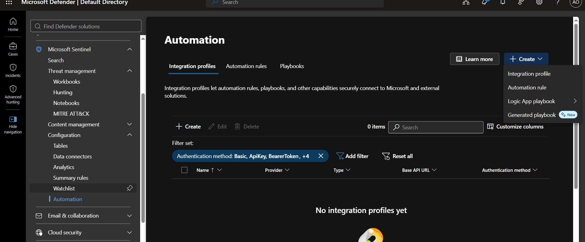
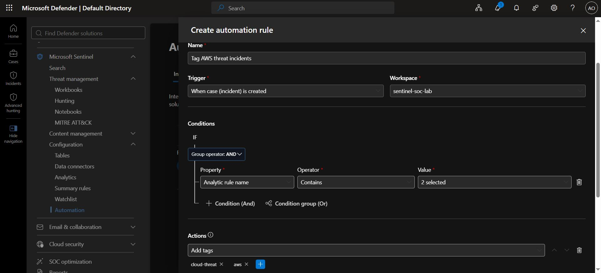
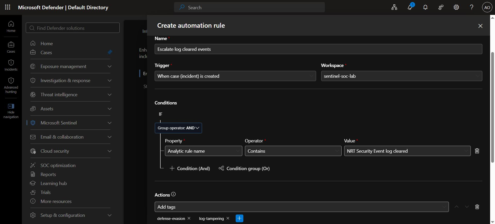
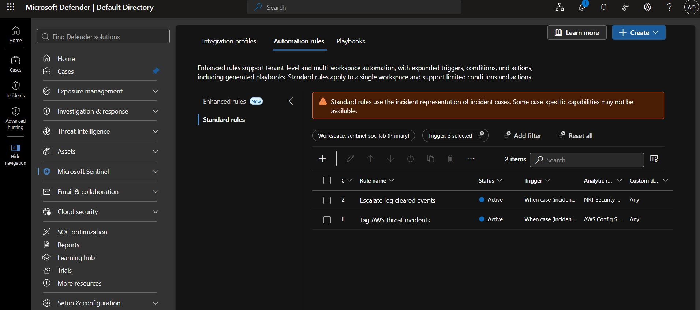

# Automation Rules

## Objective

The objective of this exercise is to create two automation rules in Microsoft Sentinel.

These rules will automatically perform actions when specific security incidents are created.

- **Rule 1:** Add the tags `cloud-threat` and `aws` to AWS-related incidents.
- **Rule 2:** Add the tags `defense-evasion` and `log-tampering` to security event log-clearing incidents and change their severity to Critical.

Automation rules help security analysts save time by performing repetitive tasks automatically.

## What Are Automation Rules?

Microsoft Sentinel automation rules allow security teams to automate incident management without writing code.

They can perform actions such as:

- Adding tags to incidents.
- Changing incident severity.
- Assigning incidents to analysts.
- Updating incident status.
- Running playbooks for advanced response actions.

**Official documentation:** [Microsoft Sentinel Automation Rules](https://learn.microsoft.com/en-us/azure/sentinel/create-manage-use-automation-rules)

# Implementation

## Step One: Review Existing Incidents

Before creating automation rules, check the incidents already available in Microsoft Sentinel.

1. Open Microsoft Defebder.
4. Navigate to **Investigation & Response > Incidents & Alerts > Incidents**.
5. Review the incidents generated by the lab detection rules.

## Step Two: Create an Automation Rule for AWS Incidents

This rule will automatically add tags to incidents generated by AWS-related analytics rules.

### Open Automation

Navigate to **Microsoft Sentinel > Configuration > Automation**.

### Configure the Rule

Enter the following settings:

| Field | Value |
|---|---|
| Name | `Tag AWS threat incidents` |
| Rule type | Standard rule |
| Trigger | When incident/case is created |
| Order | 1 |
| Status | Enabled |

### Configure the Condition

Under **Conditions**, add the following condition:

| Field | Value |
|---|---|
| Property | Analytic rule name |
| Operator | Contains |
| Value | `AWS` |

This condition tells Sentinel to look for incidents associated with analytics rule names containing `AWS`.

Examples include:

- `AWS Config Service Resource Deletion Attempts`
- `Suspicious AWS CLI Command Execution`

### Add the Tags

- Select **Add tags**.
- Enter `cloud-threat`.

- Select **Add tags**.
- Enter `aws`.

### Save the Rule

1. Review the configuration.
2. Make sure the rule is enabled.
3. Select **Apply**.

**Expected result:** New incidents that match the AWS condition will automatically receive the tags `cloud-threat` and `aws`.

## Step Three: Create an Automation Rule for Security Event Log Clearing

This rule will identify incidents associated with cleared security event logs, add two tags, and change their severity to Critical.

Clearing security logs can be suspicious because attackers may attempt to remove evidence of their activities.

### Create a New Rule

1. Navigate to **Microsoft Sentinel > Configuration > Automation**.
2. Select **Create > Automation rule**.

### Configure the Rule

| Field | Value |
|---|---|
| Name | `Escalate log cleared events` |
| Rule type | Standard rule |
| Trigger | When incident is created |
| Order | 2 |
| Status | Enabled |

### Configure the Condition

Under **Conditions**, add the following condition:

| Field | Value |
|---|---|
| Condition | Analytic rule name |
| Operator | Contains |
| Value | `Security Event log cleared` |

This condition is intended to match the lab analytics rule named `NRT Security Event log cleared`.

Ensure that the actual analytics rule name contains the text entered in the condition.

### Add the Tags

Configure the following actions.

- Select **Add tags**.
- Enter `defense-evasion`.

- Select **Add tags**.
- Enter `log-tampering`.

These tags help analysts identify incidents involving possible attempts to evade detection or interfere with security logs.

### Change the Severity

Add another action:

- Select **Change severity**.
- Set the severity to **High**.

This helps prioritize matching incidents for investigation.

### Save the Rule

1. Review the configuration.
2. Confirm that the rule is enabled.
3. Select **Apply**.

**Expected result:** New matching incidents will receive the tags `defense-evasion` and `log-tampering`, and their severity will be changed to Critical.

## Step Four: Understand Rule Ordering

Microsoft Sentinel uses the order value to determine the priority of automation rules.

A lower number represents a higher priority.

For example:

| Order | Rule Name | Condition | Actions |
|---|---|---|---|
| 1 | Tag AWS threat incidents | Analytics rule name contains `AWS` | Add `cloud-threat` and `aws` |
| 2 | Escalate log cleared events | Analytics rule name contains `Security Event log cleared` | Add `defense-evasion` and `log-tampering`; change severity to Critical |

When multiple rules match the same incident, they can execute according to their configured order, provided their triggers and conditions are satisfied.

### Understanding Conditions

Conditions determine which incidents a rule processes.

For example:

- If the analytics rule name contains `AWS`, apply the AWS tags.
- If the analytics rule name contains `Security Event log cleared`, apply the log-clearing tags and change the severity.

When multiple conditions are configured, they can use two types of logic:

- **AND:** All conditions must be true.
- **OR:** At least one condition must be true.

The two rules in this exercise use the analytics rule name as their matching condition.

## Step Five: Test the Automation Rules

After creating the rules, verify that they work correctly.

### Open the Incidents Page

1. Navigate to **Investigation & Response > Incidents & Alerts > Incidents**.
2. Find a newly created incident associated with one of the target analytics rules.
3. Open the incident.
4. Check its tags and severity.

>> Automation rules triggered when an incident is created should not be expected to update older incidents automatically.

### Verify the AWS Rule

Open a new incident that matches the AWS condition.

Confirm that it contains these tags:

- `cloud-threat`
- `aws`

### Verify the Log-Clearing Rule

Open a new incident that matches the security event log-clearing condition.

Confirm that it contains these tags:

- `defense-evasion`
- `log-tampering`

Also confirm that the severity is **Critical**.

### Generate a Test Incident if Necessary

If no new incidents have been created since you set up the rules, you can trigger them by running the detection rules manually:

- Go to **Investigation & Response > Hunting > Custom Detection Rules**.

- Find a rule and run it to generate a new incident

## Step Six: Explore Other Automation Actions

Microsoft Sentinel provides additional actions for improving incident management.

| Action | Purpose | Example |
|---|---|---|
| Assign owner | Assign an incident to a person or team. | Send phishing incidents to the email security team. |
| Change status | Update an incident's status. | Update an incident after an approved triage decision. |
| Run playbook | Start an automated workflow. | Send a Teams notification or initiate an approved response. |
| Add task | Create an investigation task. | Ask an analyst to review suspicious login activity. |
| Add tags | Categorize an incident. | Add the tag `phishing`. |
| Change severity | Change incident priority. | Escalate a serious incident to Critical. |

### What Is a Playbook?

A playbook is an automated workflow built using Azure Logic Apps.

It can perform more advanced tasks, such as:

- Sending notifications.
- Collecting additional information about an incident.
- Integrating with external security tools.
- Initiating approved incident response procedures.

Playbooks may require additional Azure resources and permissions.

For this exercise, playbooks are optional because the required tagging and severity changes can be handled through automation rules.

## 9. Key Takeaways

1. Automation rules reduce repetitive manual work.
2. Tags help analysts categorize and identify incidents.
3. Conditions determine which incidents receive automated actions.
4. Severity changes help prioritize important incidents.
5. Lower order numbers indicate higher rule priority.
6. Testing confirms whether the automation rules work correctly.
7. Playbooks can be used for more advanced response actions.

