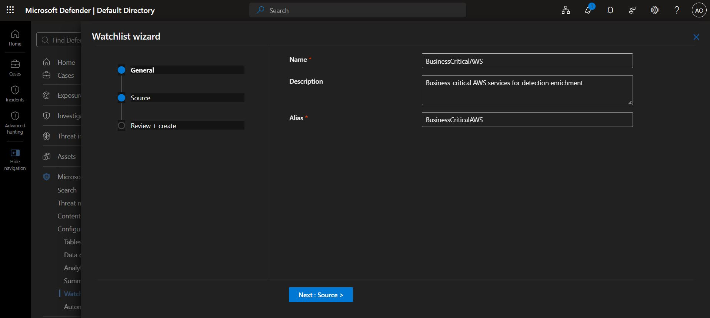
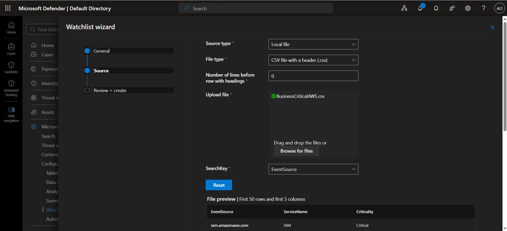
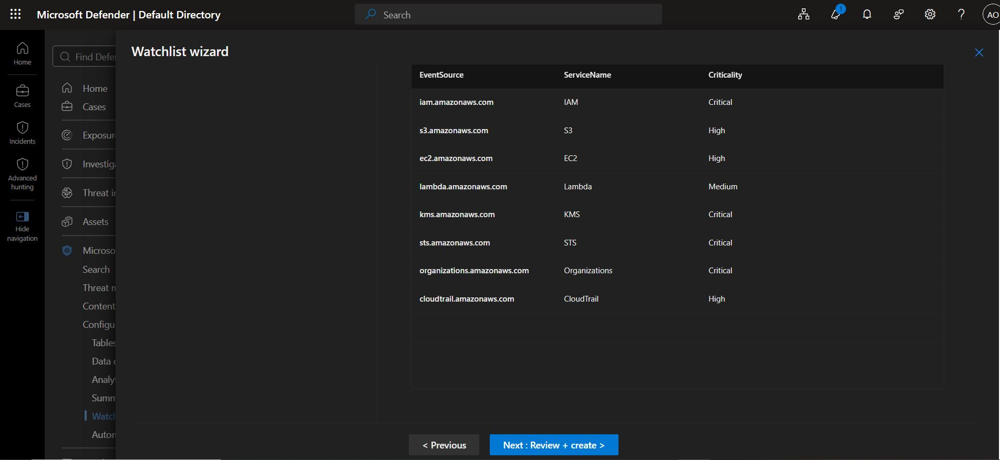
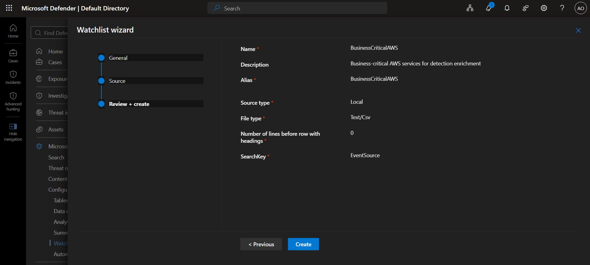
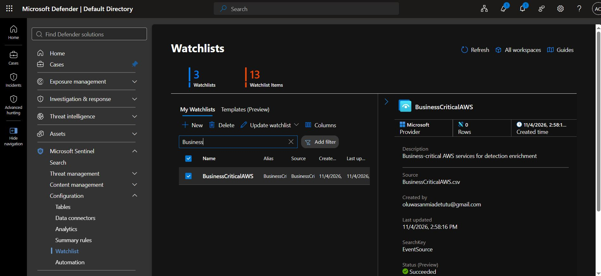
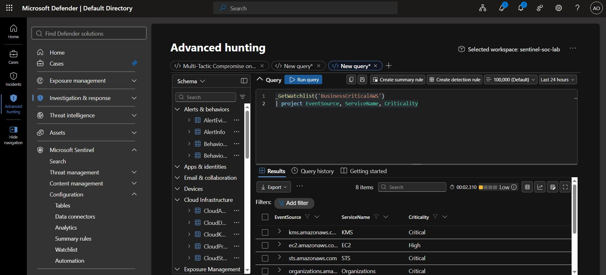
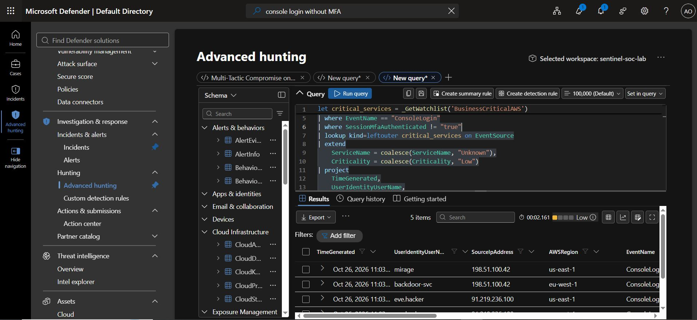
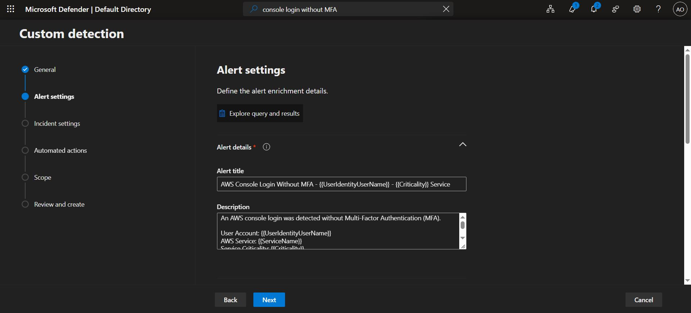

# Create a Watchlist and Integrate It into a Custom Detection Rule

## Objective

To create a watchlist in Microsoft Sentinel and integrate it into a custom detection rule using the `_GetWatchlist()` KQL function.

The goal is to improve security alerts by adding business context to AWS console logins where Multi-Factor Authentication (MFA) was not used.

## Background

The existing detection rule, `Lab Stage E4 - Console Login Without MFA (AWS)`, detects AWS console logins where MFA was not used.

However, not all AWS services have the same level of business importance.

For example:

- IAM manages identities and permissions.
- S3 stores data.
- EC2 provides virtual servers.
- Lambda runs serverless functions.
- KMS manages encryption keys.

A login without MFA involving a critical service may require more urgent investigation than one involving a less critical service.

To improve the detection rule, we will create a watchlist that maps AWS event sources to service names and business criticality levels. We will then use this watchlist to enrich security events with additional context.

## What Is a Watchlist?

A watchlist is a lookup table uploaded to Microsoft Sentinel, usually from a CSV file. It stores additional information that can be used when investigating security events.

For this exercise, the watchlist contains three columns:

- `EventSource`: The AWS event source.
- `ServiceName`: The name of the AWS service.
- `Criticality`: The business importance of the service.

The `_GetWatchlist()` KQL function retrieves watchlist data inside a query.

For example, the event source `iam.amazonaws.com` can be matched to the service name `IAM` and the criticality level `Critical`.

This information helps security analysts understand the potential business impact of a security event.

# Implementation

##  Step 1: Create the Watchlist CSV File

Create a CSV file named `BusinessCriticalAWS.csv`.

Copy the following content into the file:

    EventSource,ServiceName,Criticality
    iam.amazonaws.com,IAM,Critical
    s3.amazonaws.com,S3,High
    ec2.amazonaws.com,EC2,High
    lambda.amazonaws.com,Lambda,Medium
    kms.amazonaws.com,KMS,Critical
    sts.amazonaws.com,STS,Critical
    organizations.amazonaws.com,Organizations,Critical
    cloudtrail.amazonaws.com,CloudTrail,High

Save the file as `BusinessCriticalAWS.csv`.

Ensure that the file is saved in CSV format and that the first row contains the column headers.

## Step 2: Upload the Watchlist to Microsoft Sentinel

Follow these steps:

1. Open Microsoft Defender Portal.
2. Navigate to **Microsoft Sentinel > Configuration > Watchlist**.
3. Click **+ New**.
4. Enter the following details:

| Field | Value |
|---|---|
| Name | BusinessCriticalAWS |
| Alias | BusinessCriticalAWS |
| Description | Business-critical AWS services for detection enrichment |
| Source type | Local file |
| File | CSV file with a header (.csv) |
| SearchKey | EventSource |

5. Upload `BusinessCriticalAWS.csv`.
6. Confirm the settings and click **Create**.

7. Wait for the watchlist to become available for querying.

The alias `BusinessCriticalAWS` is the name used to reference the watchlist in KQL.

The `SearchKey` is set to `EventSource` because this field identifies the AWS service associated with each watchlist entry.

## Step 3: Verify the Watchlist

Before modifying the detection rule, confirm that Microsoft Sentinel can access the watchlist.

Open the Logs query editor for your Sentinel workspace and run the following query:

    _GetWatchlist('BusinessCriticalAWS')
    | project EventSource, ServiceName, Criticality

### Expected Result

The query should return eight rows containing the AWS services uploaded in the CSV file.

| EventSource | ServiceName | Criticality |
|---|---|---|
| iam.amazonaws.com | IAM | Critical |
| s3.amazonaws.com | S3 | High |
| ec2.amazonaws.com | EC2 | High |
| lambda.amazonaws.com | Lambda | Medium |
| kms.amazonaws.com | KMS | Critical |
| sts.amazonaws.com | STS | Critical |
| organizations.amazonaws.com | Organizations | Critical |
| cloudtrail.amazonaws.com | CloudTrail | High |

If all eight rows appear, the watchlist is accessible.

If the query fails, check the watchlist alias, upload status, and query environment.

Note: Microsoft Sentinel watchlists are queried through the supported Sentinel Logs environment. Microsoft Defender XDR Advanced Hunting is a different query environment and may not support the same watchlist functions.

## Step 4: Modify the Detection Rule

Create a detection rule:

`Console Login Without MFA (AWS)`

Use the following :

    let critical_services = _GetWatchlist('BusinessCriticalAWS')
        | project EventSource, ServiceName, Criticality;
    AWSCloudTrail
    | where TimeGenerated > ago(4h)
    | where EventName == "ConsoleLogin"
    | where SessionMfaAuthenticated != "true"
    | lookup kind=leftouter critical_services on EventSource
    | extend
        ServiceName = coalesce(ServiceName, "Unknown"),
        Criticality = coalesce(Criticality, "Low")
    | project
        TimeGenerated,
        UserIdentityUserName,
        SourceIpAddress,
        AWSRegion,
        EventName,
        EventSource,
        ServiceName,
        Criticality,
        MfaAuthenticated = SessionMfaAuthenticated
    | extend
        AccountUpn = UserIdentityUserName,
        RemoteIP = SourceIpAddress,
        ReportId = tostring(hash_sha256(strcat(
            UserIdentityUserName,
            SourceIpAddress,
            tostring(TimeGenerated)
        )))

### 4.1. Load the Watchlist

The following code retrieves the watchlist:

    let critical_services = _GetWatchlist('BusinessCriticalAWS')
        | project EventSource, ServiceName, Criticality;

The `let` statement creates a temporary variable named `critical_services`.

This variable contains the event source, service name, and criticality columns from the watchlist.

The query can use this variable later when matching AWS events to watchlist entries.

### 4.2. Find AWS Console Logins Without MFA

The following conditions select the relevant AWS CloudTrail events:

    AWSCloudTrail
    | where TimeGenerated > ago(4h)
    | where EventName == "ConsoleLogin"
    | where SessionMfaAuthenticated != "true"

These conditions mean:

- `AWSCloudTrail` reads AWS CloudTrail events.
- `TimeGenerated > ago(4h)` selects events from the last four hours.
- `EventName == "ConsoleLogin"` selects console login events.
- `SessionMfaAuthenticated != "true"` selects events where MFA was not recorded as authenticated.

The four-hour time range can be adjusted to meet the requirements of the detection rule.

### 4.3. Match Events to the Watchlist

The following line joins the AWS events to the watchlist:

    | lookup kind=leftouter critical_services on EventSource

The query compares the `EventSource` field in each AWS event with the `EventSource` field in the watchlist.

For example:

- EventSource: `iam.amazonaws.com`
- ServiceName: `IAM`
- Criticality: `Critical`

The `leftouter` lookup preserves the original AWS events even when there is no matching watchlist entry.

This means that events involving services not listed in the watchlist are not automatically removed.

### 4.4. Assign Default Values

The following code handles events that do not match a watchlist entry:

    | extend
        ServiceName = coalesce(ServiceName, "Unknown"),
        Criticality = coalesce(Criticality, "Low")

The `coalesce()` function returns the first non-null value.

If a matching watchlist entry exists, the query uses its service name and criticality.

If no matching entry exists, the query assigns these defaults:

- `ServiceName`: `Unknown`
- `Criticality`: `Low`

This makes the results easier to interpret.

### 4.5. Select the Output Fields

The `project` statement specifies which fields should appear in the query results:

    | project
        TimeGenerated,
        UserIdentityUserName,
        SourceIpAddress,
        AWSRegion,
        EventName,
        EventSource,
        ServiceName,
        Criticality,
        MfaAuthenticated = SessionMfaAuthenticated

These fields include the original event details and the additional business context provided by the watchlist.

The final `extend` statement creates additional fields:

- `AccountUpn`: Copies the username into a field that may be used for account entity mapping.
- `RemoteIP`: Copies the source IP address into a field that may be used for IP entity mapping.
- `ReportId`: Generates a hash from the username, source IP address, and event timestamp.

Verify that these fields are compatible with the detection rule's required output fields, alert configuration, and entity mappings.

### 4.6 Choose Whether to Enrich or Filter Events

There are two main ways to use a watchlist in a detection rule.

### Option A: Enrich All Matching Events

The main query uses:

    | lookup kind=leftouter critical_services on EventSource

This approach keeps non-MFA console login events and adds service information when a matching watchlist entry exists.

Use this option when you want to detect all relevant non-MFA console logins while providing analysts with additional business context.

For example, an event involving IAM could include:

- ServiceName: `IAM`
- Criticality: `Critical`

An event involving a service that is not in the watchlist could include:

- ServiceName: `Unknown`
- Criticality: `Low`

### Option B: Detect Only Critical Services

If you only want to detect non-MFA console logins involving critical services, use the following query instead:

    let critical_services = _GetWatchlist('BusinessCriticalAWS')
        | where Criticality == "Critical"
        | project EventSource;
    AWSCloudTrail
    | where TimeGenerated > ago(4h)
    | where EventName == "ConsoleLogin"
    | where SessionMfaAuthenticated != "true"
    | where EventSource in (critical_services)

This query works in two stages.

First, it retrieves only the watchlist entries classified as `Critical`.

Second, it returns only non-MFA console login events whose event sources appear in that list.

Unlike Option A, this query filters out events involving services that are not classified as critical.

### Which Option Should You Use?

- Choose Option A if you want all relevant non-MFA console logins with additional business context.
- Choose Option B if you only want alerts for non-MFA console logins involving critical services.

### 7.7 Update the Alert Title

Update the detection rule's alert title to include the username and service criticality.

Use the following title as a starting point:

    Console login without MFA by {{UserIdentityUserName}} — {{Criticality}} service

For example, an alert could be titled:

    Console login without MFA by admin-user — Critical service

Important: Confirm that your Microsoft Sentinel rule supports the proposed dynamic placeholders. Arbitrary KQL result columns may not be available as dynamic alert-title placeholders in the format shown above.

If the rule does not support these placeholders, use the supported alert-detail configuration to expose the username and criticality in the alert.

## Step 7: Save, Enable, and Test the Rule

Complete the following steps:

1. Save the modified query.
2. Run the query manually and confirm that it returns the expected results.
3. Check that `ServiceName` and `Criticality` appear in the results.
4. Confirm that matching watchlist entries receive the correct values.
5. Confirm that unmatched event sources receive the default values.
6. Verify that the alert configuration and entity mappings are correct.
7. Save and enable the detection rule.
8. Review the generated alerts to confirm that the enriched information is available.

If the query returns no results, check:

- The selected time range.
- Whether AWS CloudTrail data is being ingested.
- Whether matching non-MFA console login events exist.
- Whether the watchlist alias is correct.
- Whether the event source values match those in the watchlist.

## Key Takeaways

- Watchlists add business context to security events.
- CSV files provide a simple way to create watchlists.
- `_GetWatchlist('BusinessCriticalAWS')` retrieves watchlist data in KQL.
- `lookup kind=leftouter` enriches events without discarding unmatched events.
- `coalesce()` assigns default values when watchlist information is missing.
- The `in` operator can filter events to specific watchlist entries.
- The `SearchKey` should be configured to support the intended matching field.
- Enrichment and filtering serve different purposes.
- Testing the query and alert configuration before enabling the rule helps prevent detection issues.

